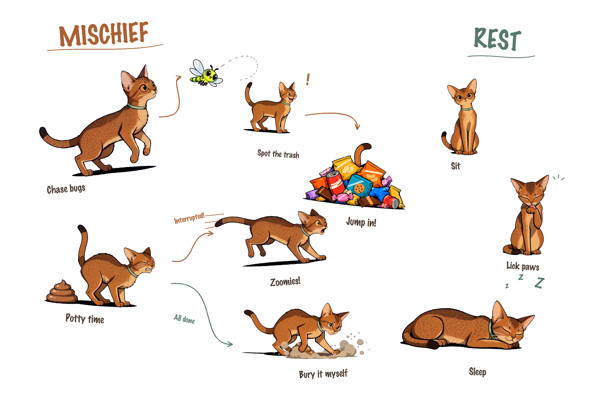

# Chaos Cat



Chaos Cat 是一只会和编辑器联动的 macOS 桌面小猫：输入时追虫，看到垃圾堆会跳进去，还会在代码里留下 `/shit/` 标记，再把它们逐个埋掉。

桌面端负责动画、移动和菜单栏控制；编辑器扩展负责文档坐标、输入事件以及文本标记的插入和删除。两者通过仅监听本机的 bridge（默认 `127.0.0.1:44777`）通信。

## 功能与触发规则

小猫平时处于**行走状态**：启动 App 后自动在屏幕上移动，走到边缘会转向。任何动作结束、被取消或清理后，都会回到行走。

### 追虫（输入触发）

- **何时触发**：VS Code 编辑器中发生输入时，系统每 3 秒最多检查一次，并以 12% 的概率生成虫子；编辑器闲置时不会触发。在非编辑器应用中，每 8 秒以 3% 概率检查是否生成虫子。也可以通过命令面板手动触发。
- **触发条件**：编辑器输入触发需有正在编辑的文档，且当前没有处于追虫冷却期。一次追虫结束后会进入 25 秒冷却。
- **如何退出**：小猫接近虫子后会扑击并结束；也可以点击虫子驱逐、拖拽小猫，切换前台应用，或等待 16 秒超时退出。退出后回到行走。

### 垃圾堆

- **何时触发**：从命令面板执行“跳垃圾堆”，或小猫在行走时遇到已生成的垃圾堆。
- **触发条件**：小猫距离垃圾堆不超过 320pt，并且面朝垃圾堆，才会进入发现、冲刺和跳入动画。进入前会在当前文档插入临时 `/rubbish/` 占位，原有文字会被保留并挤开。
- **如何退出**：跳入后会持续摇尾巴，直到点击小猫、拖拽小猫或执行其他动作。退出时只删除本次插入的 `/rubbish/`，保留期间用户对文档做的其他编辑；随后回到行走。

### 拉屎（插入 `/shit/`）

- **何时触发**：从命令面板执行“Trigger Poop Chaos”，或选择桌面菜单中的调试动作。
- **触发条件**：一次动作包含 3 轮，中间穿插行走。在已连接的编辑区内，把可见、可选、可搜索、可复制的 `/shit/` 插入真实文档；非编辑区使用可点击清理的浮层。
- **如何退出**：完成 3 轮后自动回到行走。执行“清理所有屎标记”会立即取消剩余轮次、取消尚未执行的延迟插入，并清除已连接文档中的所有已记录标记。被拖拽或其他动作打断时，小猫会先受惊狂奔，再结束本轮动作。

### 埋屎（删除 `/shit/`）

- **何时触发**：快速拖拽松手后；也可以执行“调试埋屎动画”。
- **触发条件**：编辑器中存在小猫自己记录的 `/shit/` 标记。小猫会根据标记的实时文档坐标寻路，编辑器滚动或内容变化后会重新定位。
- **如何退出**：到达标记位置并播放到粪便消失帧时，才删除对应的 `/shit/`；删除后走向下一处。没有剩余标记时立即回到行走。只会删除对应标记，不会改动周围文字。

### 拖拽

- **何时触发**：按住并拖动小猫时进入提起 → 悬空保持 → 放下三段动画。
- **触发条件**：轻拖只移动小猫；一次拖拽累计移动至少 24pt 且峰值速度达到 900pt/s，松手后才会触发埋屎。拖拽期间保留文档原内容。
- **如何退出**：松手播放放下动画；快速拖拽会在放下后寻找并埋掉一个真实标记，轻拖则在放下后衔接蹲坐起身，再回到行走。重新抓起会取消上一次拖拽的待执行回调。

### 休息

- **何时触发**：小猫完成当前动作并进入空闲后随机休息：蹲坐 60%、舔爪 28%、睡觉 12%。
- **触发条件**：只有行走空闲时才会开始，进行中的追虫、垃圾堆、拉屎和拖拽动作不会被休息抢占。
- **如何退出**：蹲坐和舔爪播放结束后起身；睡觉会完成 3–5 次呼吸循环后起身。菜单调试动作、输入触发追虫、点击或拖拽都可以打断休息并立即切换。

## 安装和运行

### 下载安装包

从 [最新发布页](https://github.com/alde998/ChaoCat/releases/latest) 下载 **Chaos-Cat-0.1.3-macOS-arm64.dmg**，打开后把 `ChaosCat.app` 拖到“应用程序”。当前安装包适用于 Apple Silicon（M1 及更新芯片）和 macOS 13 及以上。

安装包内置 Node.js、动画和 VS Code 插件，无需安装开发工具。首次启动会尝试安装内置插件；也可以点击小猫菜单中的“安装 VS Code 插件”。更新后请退出旧版小猫、打开新版，并在 VS Code 执行 **Developer: Restart Extension Host**。

本次 0.1.3 更新修复本机 bridge 鉴权与 WebSocket 分包处理，清理仅删除小猫拥有的标记，保留用户原有 `/shit/` 文本；统一动画绿色项圈并修正追虫阴影。动画保留原尺寸、帧数、透明度和播放时长。

当前安装包使用 ad-hoc 签名，尚未通过 Apple 公证。若系统提示无法验证开发者，请确认下载来源后，按镜像内的安装说明为该 App 单独允许打开。

### 直接运行源码

要求：macOS 13 或更高版本、Swift 5.9+、Node.js、Python 3 和 Pillow。

```sh
git clone https://github.com/alde998/ChaoCat.git
cd ChaoCat
npm install
npm run build:macos
open apps/macos/ChaosCat.app
```

App 会自动启动本地 bridge。打开文本文件并聚焦编辑器，状态栏显示 **小猫 · 已联动** 后即可使用。也可以在小猫菜单中选择“安装 VS Code 插件”。

如果 Python 找不到 Pillow，可指定解释器：

```sh
CHAOS_CAT_PYTHON=/path/to/python3 npm run build:macos
```

### 手动安装 VS Code 扩展

```sh
python3 scripts/package_vscode.py
code --install-extension dist/chaos-cat-*.vsix --force
```

扩展要求 VS Code 1.79 或更高版本。更新扩展后执行 **Developer: Restart Extension Host**。

### Obsidian

Obsidian 适配器位于 [`extensions/obsidian`](extensions/obsidian)。它需要 Obsidian 1.5 或更高版本，并与同一个本地 bridge 配合使用。开发时将该目录作为插件目录加载即可。

## 常用操作

在 VS Code 命令面板中搜索 `Chaos Cat`，常用命令包括：

- `Chaos Cat: 查看联动诊断`
- `Chaos Cat: Trigger Bug Chase`
- `Chaos Cat: 跳垃圾堆`
- `Chaos Cat: Trigger Poop Chaos`
- `Chaos Cat: 调试埋屎动画`
- `Chaos Cat: 立即清理所有屎`
- `Chaos Cat: Calm`

也可以直接点击状态栏“小猫 · 已联动”查看 bridge、桌宠和当前编辑器的连接状态。

## 开发

```sh
npm run bridge        # 只启动本地 bridge
npm run smoke         # 基础 smoke test
npm run build:macos   # 构建 ChaosCat.app
npm run package:macos # 构建 App、pkg 和 dmg
```

bridge 默认监听 `127.0.0.1:44777`，可通过环境变量修改：

```sh
CHAOS_CAT_PORT=44778 npm run bridge
```

bridge 会为本机客户端生成权限令牌并保存到临时目录。不要把令牌提交到仓库，也不要把 bridge 暴露到公网。

## 测试和验证

```sh
node --test tests/bridge-auth.test.mjs tests/bridge.test.mjs tests/markers.test.cjs
bash tests/run-drag-tests.sh
python3 tests/behavior-assets.py
node tests/run-vscode-host.mjs
node tests/run-vscode-host.mjs --auth-only
```

`run-vscode-host.mjs` 会启动隔离的 VS Code 扩展测试宿主，覆盖真实输入、标记插入、撤销/重做、保存、埋屎删除、垃圾堆恢复和跨文档清理。完整的动画与素材验证脚本位于 `tests/`，验证记录保存在本地 `docs/`，不推送远程仓库。

## 打包发布

```sh
npm run package:macos
```

该命令会构建 App，并生成当前机器架构的 `.pkg` 和 `.dmg`。没有 Apple Developer 证书时使用 ad-hoc 签名，无法完成 Apple 公证；分发给其他 Mac 时可能需要在“系统设置 → 隐私与安全性”中手动允许打开。

构建所需的当前动画、图片和图标都在仓库中。安装包和构建缓存输出到 `dist/`，不属于源码依赖。

## 项目结构

```text
apps/macos/           macOS 原生桌宠和菜单栏 App
apps/bridge/          本地 HTTP/WebSocket bridge
extensions/vscode/    VS Code 扩展
extensions/obsidian/  Obsidian 适配器
shared/               bridge 协议和共享资源
media/                动画、图片和视频素材
scripts/               构建、打包和素材处理脚本
tests/                 单元、集成和宿主测试
docs/                  本地验证记录和行为说明
```

## 许可证

当前仓库未声明开源许可证，仅供本地开发和测试使用。
